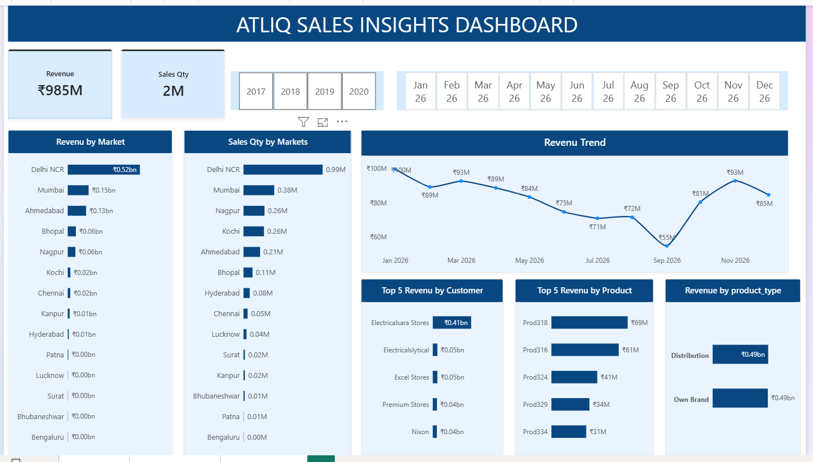
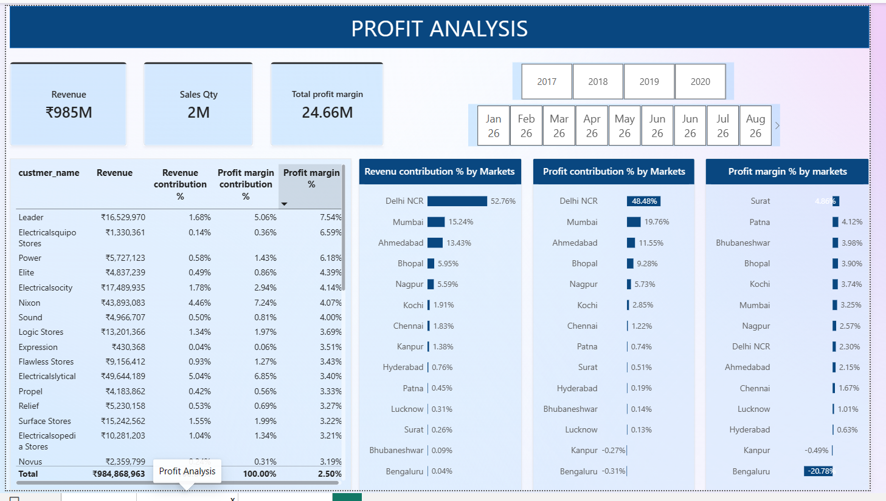
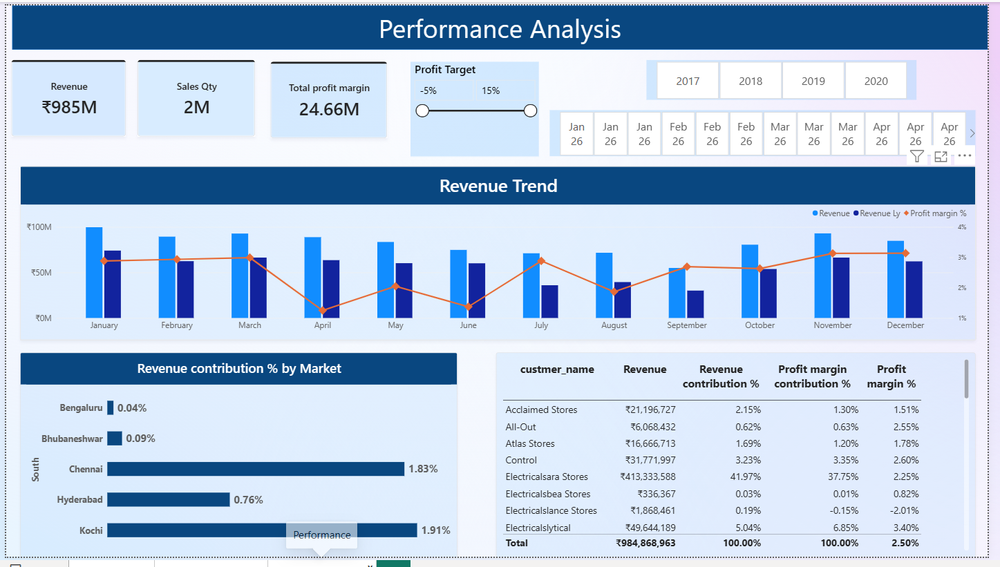

# Sales-Insight-Analytics 

##  Project Overview

The AtliQ Sales Insights Dashboard is a data analysis project developed using Power BI to analyze sales performance and profitability. The project uses sales transaction data along with customer, product, market, and date tables to generate meaningful business insights.
The dashboard consists of three pages: Sales Insights Dashboard, Performance Analysis, and Profit Analysis. It helps analyze total revenue, sales quantity, market performance, top customers, top products, revenue trends, and profit margins.
The main objective of this project is to transform raw sales data into interactive dashboards that help businesses understand sales trends, identify high-performing markets and products, monitor profitability, and make data-driven decisions.

## Project Objectives

- To analyze overall sales revenue and sales quantity.
- To identify top-performing markets, customers, and products.
- To track monthly revenue trends and compare sales performance over time.
- To evaluate profit margins and market-wise profitability.
- To identify low-performing markets and customers with low or negative profit margins.
- To create interactive Power BI dashboards that help users explore sales data and make data-driven business decisions.

##  Tools & Technologies

- **Microsoft Power BI** – Dashboard creation and data visualization
- **Power Query** – Data cleaning and transformation
- **DAX** – Measures and calculations
- **CSV Files** – Data sources

##  Dataset Files

The project uses four CSV files:

| File | Description |
|---|---|
| `Sales transaction.csv` | product codes,customer codes,market codes,order dates,sales_qty, sales amount,currency, and profit-related fields. |
| `Sales date.csv` | calendar dates, years, month names, and date labels |
| `Sales customer.csv` | customer codes, customer names, and customer types. |
| `Sales product.csv` | product codes and product types|
| `Sales market.csv`   |market codes, market names, and zones |

##  Dashboard Pages

### 1. Sales_insight

#### - Key Performance Indicators (KPIs)

   - Total Revenue: Displays the total sales revenue generated.
   - Sales Quantity: Shows the total quantity of products sold.

#### Key Visualizations

   - Revenue by Market: Compares revenue generated across different markets.
   - Sales Quantity by Markets: Shows the quantity of products sold in each market.
   - Revenue Trend: Displays monthly revenue changes to identify sales trends over time.
   - Top 5 Revenue by Customer: Identifies the top five customers contributing the highest revenue.
   - Top 5 Revenue by Product: Highlights the five products generating the highest revenue.
   - Revenue by Product Type: Compares revenue contribution from Own Brand and Distribution products.

### 2. Profit_Analysis

#### Key Performance Indicators (KPIs)

   - Total Revenue: Displays the total revenue generated under the selected filters.
   - Sales Quantity: Shows the total quantity of products sold.
   - Total Profit Margin: Displays the total profit margin value calculated in the report.

#### Key Visualizations

   - Customer Performance Table: Displays customer-wise revenue, revenue contribution percentage, profit margin contribution percentage, and   profit margin percentage.
   - Revenue Contribution % by Markets: Compares the percentage of revenue contributed by each market.
   - Profit Contribution % by Markets: Shows each market's share of the total profit contribution.
   - Profit Margin % by Markets: Compares profit margin percentages across different markets.
   - Year and Month Slicers: Allow users to filter the analysis by selected time periods.

### 3. Performance_Analysis

#### Key Performance Indicators (KPIs)

   - Total Revenue: Displays the revenue generated under the selected filters.
   - Sales Quantity: Shows the total quantity of products sold.
   - Total Profit Margin: Displays the total profit margin value calculated in the report.

#### Key Visualizations

   - Revenue Trend: Compares current revenue with last year's revenue and displays profit margin percentage over time.
   - Revenue Contribution % by Market: Shows the percentage contribution of each market to total revenue.
   - Customer Performance Table: Displays customer names, revenue, revenue contribution percentage, profit margin contribution percentage, and profit margin percentage.
   - Year and Month Slicers: Allow users to analyze performance for specific years and months.
   - Profit Target Control: Allows users to adjust the target range and evaluate performance against the target, based on the report's configured measures.

## 🔗 Data Modeling
The report connects the four tables using relationships between their relevant keys:

  - Sales Customer → Sales Transaction
  - Sales Product → Sales Transaction
  - Sales Date → Sales Transaction
  - Sales Market → Sales Transaction

These relationships help analyze sales, customer, product, and payment data together.

##  Key Insights
The dashboards can help users:

  - Analyze overall sales revenue and sales quantity.
  - Identify top-performing markets, customers, and products.
  - Track monthly revenue trends and compare sales performance over time.
  - Evaluate profit margins and identify markets with negative profitability.
  - Compare revenue contribution and profit contribution across markets.
  - Identify customers and products that contribute significantly to sales.
  - Filter data by year and month to explore specific periods.
  - Make data-driven decisions to improve sales performance, profitability, and business strategies.

##  Project Structure

text
Sales-Insight-Analysis/
├── Sales_insight dashboard.pbix
├── Sales transaction.csv
├── Sales customers.csv
├── Sales products.csv
├── Sales date.csv
├── Sales market
└── README.md
├── sales-analysis.png
├── customer-details.png
└── product-performance.png

## Dashboards

### 1. Sales_insight

### Conclusion

- The Sales Insights Dashboard helps users understand overall sales performance, identify major revenue contributors, compare market performance, and monitor monthly sales trends. These insights support better sales planning and business decision-making.

### 2. Profit_Analysis

### Conclusion

- The Profit Analysis Dashboard helps evaluate market-wise and customer-wise profitability. It highlights differences between revenue contribution and profit margin, helping businesses identify areas that may require cost control, pricing improvements, and better sales strategies.

### 3. Performance_Analysis

### Conclusion

- The Performance Analysis Dashboard helps monitor sales performance, compare revenue over time, and evaluate customer and market contributions. It supports business decisions by highlighting performance trends and identifying areas where sales strategies, pricing, or cost management may need improvement.

## Overall conclusion

- The AtliQ Sales Insights Dashboard project demonstrates how Power BI can transform raw sales data into meaningful business insights. By using data cleaning, data modeling, DAX measures, and interactive visualizations, the project analyzes sales revenue, sales quantity, market performance, customer contributions, product performance, and profitability
- The three dashboard pages—Sales Insights, Performance Analysis, and Profit Analysis—provide a clear view of business performance and help identify sales trends, high-performing markets, and areas with low or negative profit margins.
- Overall, this project improves understanding of sales data analysis and demonstrates how data visualization can support data-driven decision-making, better sales planning, and improved profitability.
